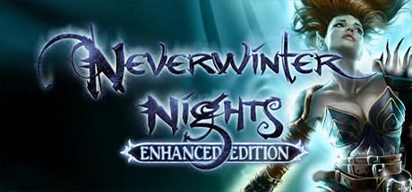

**Neverwinter Nights is the iconic D&D RPG featuring a single-player campaign where a lone adventurer stops a plague threatening the city of Neverwinter. Best known for its Aurora Toolset that let players create and share custom campaigns for over two decades.**

---

## 📖 About

Neverwinter Nights is the iconic D&D RPG featuring a single-player campaign where a lone adventurer stops a plague threatening the city of Neverwinter. Best known for its Aurora Toolset that let players create and share custom campaigns for over two decades.

## ⚠️ Problems Without Trainer

| Problem | Status |
|---------|--------|
| **Henchman Dependency** — Single henchman companion limits party building compared to later D&D games | ✅ Solved |
| **NWN 1 Campaign Quality** — Original campaign considered weaker than Hordes and SoU expansions | ✅ Solved |
| **Third Edition Rules** — D&D 3.0 rules complexity is steep for players without tabletop background | ✅ Solved |
| **Multiplayer Server Decline** — Persistent server community has dramatically shrunk over the years | ✅ Solved |

## ✅ Solution

The **Neverwinter Nights Trainer** solves all these issues by giving you complete control over the game.

## 🎯 Full Feature List

- Unlimited Resources
- God Mode / Invincibility
- Instant Skill Cooldown
- One-Hit Kill
- Freeze Game Timer
- Unlock All Items & Achievements
- Custom Speed Multiplier
- Save State Anywhere

## 🚀 Quick Start

1. **Disable Windows Defender** temporarily (trainer may trigger false positive)
2. Download the trainer from the button above
3. Launch Neverwinter Nights
4. Run the trainer as Administrator
5. Activate desired cheats with hotkeys

## 💎 Free vs Paid

| Feature | Free | Pro |
|---------|------|-----|
| Basic God Mode | ✅ | ✅ |
| Unlimited Resources | ✅ | ✅ |
| All Advanced Cheats | ❌ | ✅ |
| Auto-Updates | ❌ | ✅ |
| Priority Support | ❌ | ✅ |

## 💻 Requirements

- Windows 10/11 (64-bit)
- Neverwinter Nights (any version)
- .NET Framework 4.8+
- DirectX 11+

## 🍎 macOS

macOS users can use our alternative tool:

## ⚖️ Legal

This trainer is for educational and single-player use only. Use responsibly.

---

